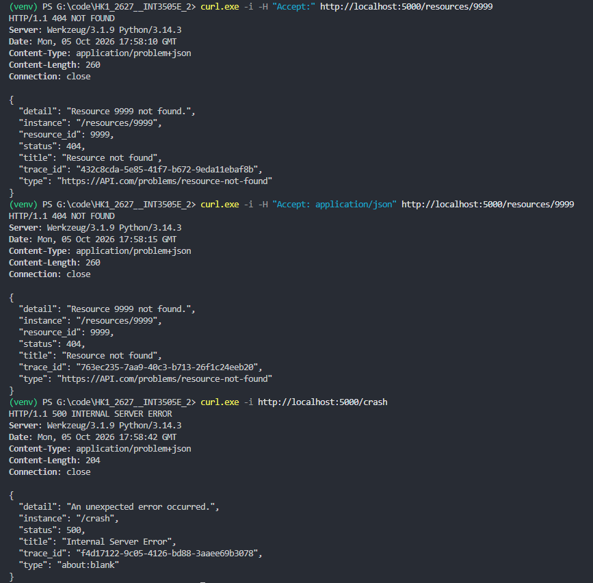
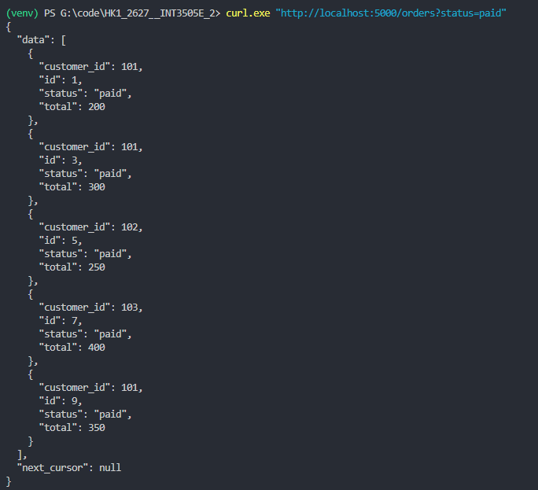
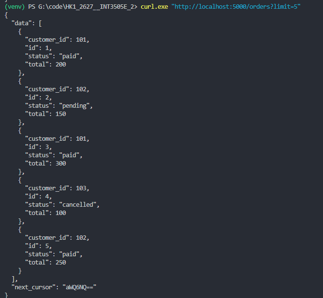
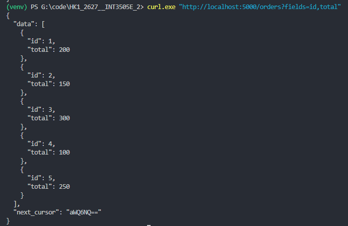
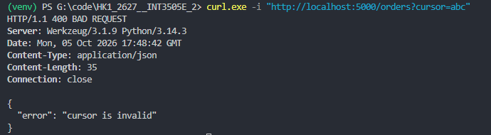

# BT Buổi 3

## Bài 1

**Thiết kế tài nguyên và endpoint cho API bài viết:**

- Xác định các tài nguyên: Users, Posts, Comments, Tags, Profiles và Followers.
- Phân loại collection, item, sub-resource và sử dụng tiền tố phiên bản `/v1`.

## Bài 2

**1. Kiểm tra tài nguyên không tồn tại:**

- Gọi `GET /resources/9999`, trả về mã `404 NOT FOUND`.
- Cả hai yêu cầu với header `Accept:` rỗng và `Accept: application/json` đều trả về `Content-Type: application/problem+json`.
- Body chứa các trường `type`, `title`, `status`, `detail`, `instance`, `trace_id` và `resource_id`.

**2. Kiểm tra lỗi hệ thống:**

- Gọi `GET /crash`, trả về mã `500 INTERNAL SERVER ERROR` với định dạng `application/problem+json`.
- Trường `detail` chứa thông báo chung `An unexpected error occurred.`, không trả về chi tiết lỗi nội bộ.

## Bài 3

**1. Kiểm tra lọc đơn hàng theo trạng thái:**

- Gọi `GET /orders?status=paid`, trả về các đơn hàng có trạng thái `paid` với id: 1, 3, 5, 7, 9.
- `next_cursor: null` vì không còn dữ liệu ở trang tiếp theo.

**2. Kiểm tra phân trang bằng cursor:**

- Gọi `GET /orders?limit=5`, trả về 5 đơn hàng đầu tiên với id từ 1 đến 5.
- Body chứa `next_cursor` để lấy trang tiếp theo bằng tham số `cursor`.

**3. Kiểm tra chọn trường dữ liệu trả về:**

- Gọi `GET /orders?fields=id,total`, mỗi đơn hàng chỉ chứa hai trường `id` và `total`.
- Kết quả vẫn có `next_cursor` để tiếp tục phân trang.

**4. Kiểm tra cursor không hợp lệ:**

- Gọi `GET /orders?cursor=abc`, trả về mã `400 BAD REQUEST`.
- Body chứa thông báo `{"error": "cursor is invalid"}`.
