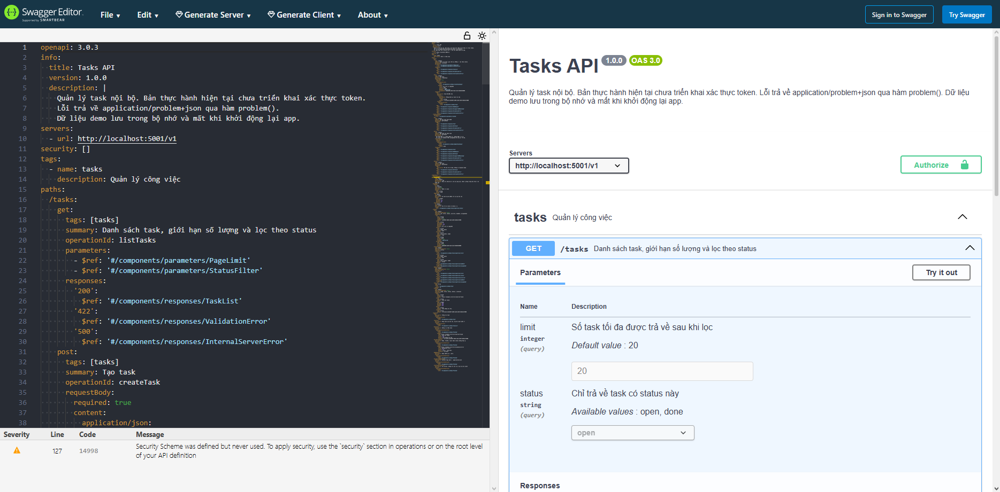
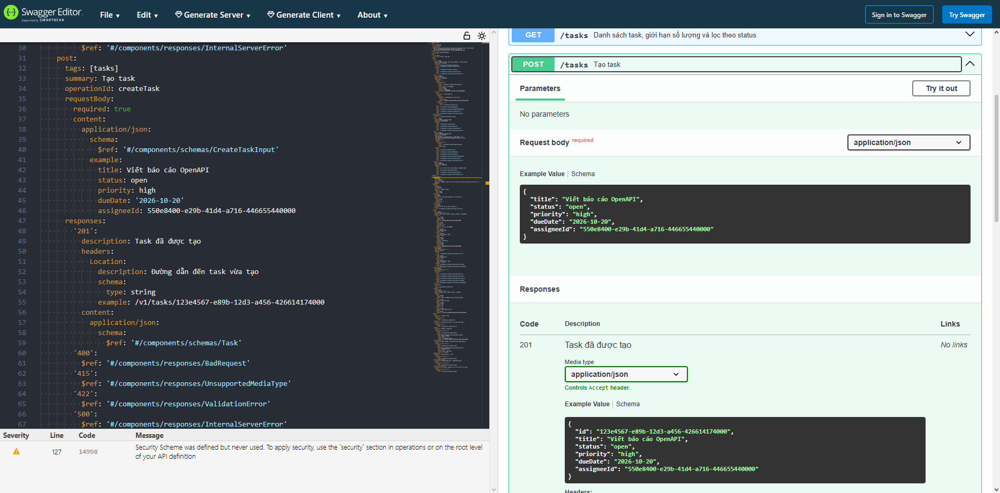
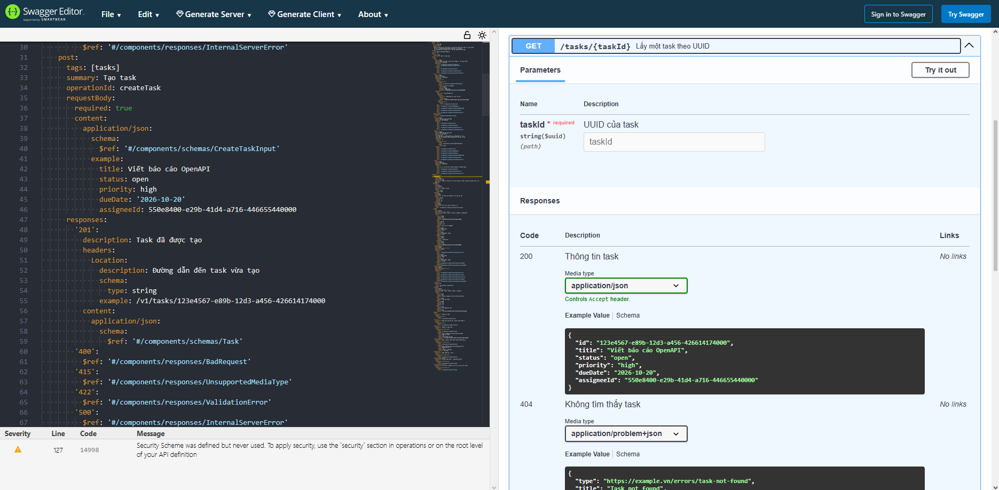
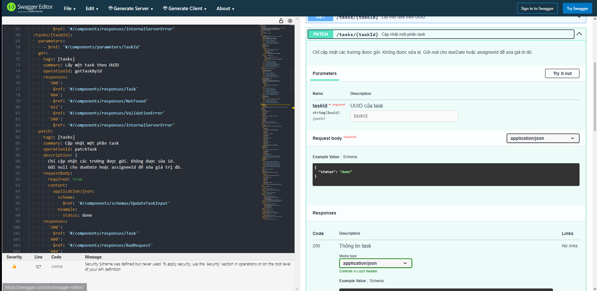
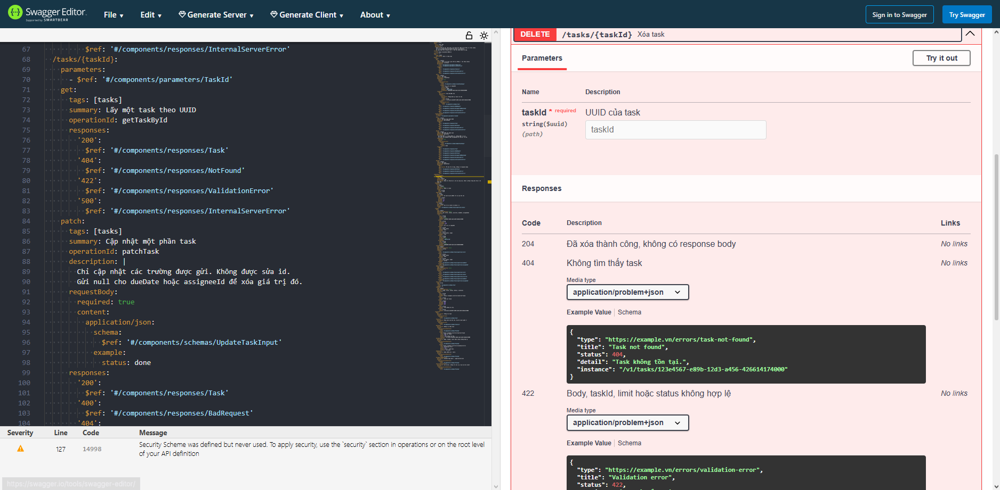

# BT Buổi 4

## Bài 1: OpenAPI cho Tasks API

Đặc tả `tasks-API.yaml` dùng OpenAPI 3.0.3, mô tả 5 endpoint quản lý task.

**1. Lấy danh sách task — GET /tasks:**

- Hỗ trợ `limit` để giới hạn số lượng (mặc định 20, tối đa 100) và `status` để lọc theo `open` hoặc `done`.

Các response:

- `200 OK`: Trả mảng task sau khi lọc và giới hạn số lượng; có thể là `[]`.
- `422 UNPROCESSABLE ENTITY`: `limit` không phải số nguyên từ 1–100 hoặc `status` không hợp lệ.
- `500 INTERNAL SERVER ERROR`: Lỗi xử lý phía server, trả thông báo chung.

**2. Tạo task — POST /tasks:**

- Body JSON gồm `title`, `status`, `priority`, `dueDate` và `assigneeId`; `title` là bắt buộc.

Các response:

- `201 CREATED`: Trả thông tin task mới và header `Location` trỏ đến task đó.
- `400 BAD REQUEST`: Body JSON sai cú pháp.
- `415 UNSUPPORTED MEDIA TYPE`: Content-Type không phải `application/json`.
- `422 UNPROCESSABLE ENTITY`: Body không hợp lệ, ví dụ thiếu `title`, sai kiểu dữ liệu hoặc có field thừa.
- `500 INTERNAL SERVER ERROR`: Lỗi xử lý phía server, trả thông báo chung.

**3. Lấy chi tiết task — GET /tasks/{taskId}:**

- Tham số `taskId` bắt buộc, có định dạng UUID.

Các response:

- `200 OK`: Trả thông tin task có UUID tương ứng.
- `404 NOT FOUND`: UUID hợp lệ nhưng task không tồn tại.
- `422 UNPROCESSABLE ENTITY`: `taskId` không đúng định dạng UUID.
- `500 INTERNAL SERVER ERROR`: Lỗi xử lý phía server, trả thông báo chung.

**4. Cập nhật một phần task — PATCH /tasks/{taskId}:**

- Chỉ cập nhật các trường được gửi, ví dụ `{"status":"done"}`; không được sửa `id`.

Các response:

- `200 OK`: Trả thông tin task sau cập nhật; các trường không gửi giữ nguyên.
- `400 BAD REQUEST`: Body JSON sai cú pháp.
- `404 NOT FOUND`: UUID hợp lệ nhưng task không tồn tại.
- `415 UNSUPPORTED MEDIA TYPE`: Content-Type không phải `application/json`.
- `422 UNPROCESSABLE ENTITY`: `taskId` sai định dạng hoặc body không hợp lệ, ví dụ `{}` hay sửa `id`.
- `500 INTERNAL SERVER ERROR`: Lỗi xử lý phía server, trả thông báo chung.

**5. Xóa task — DELETE /tasks/{taskId}:**

Các response:

- `204 NO CONTENT`: Xóa thành công, không có response body.
- `404 NOT FOUND`: UUID hợp lệ nhưng task không tồn tại hoặc đã bị xóa.
- `422 UNPROCESSABLE ENTITY`: `taskId` không đúng định dạng UUID.
- `500 INTERNAL SERVER ERROR`: Lỗi xử lý phía server, trả thông báo chung.
