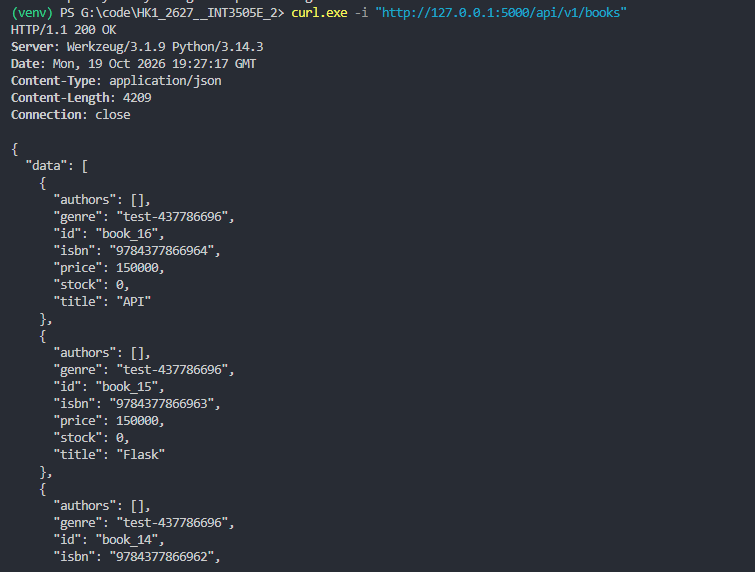
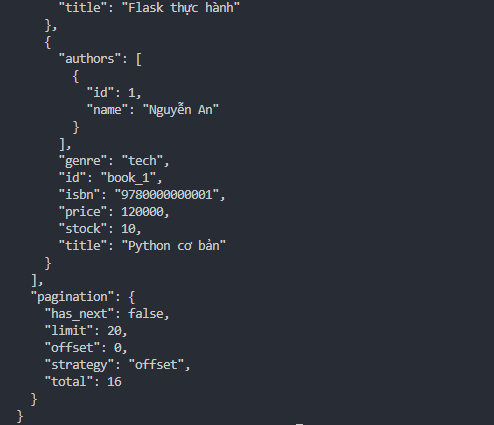
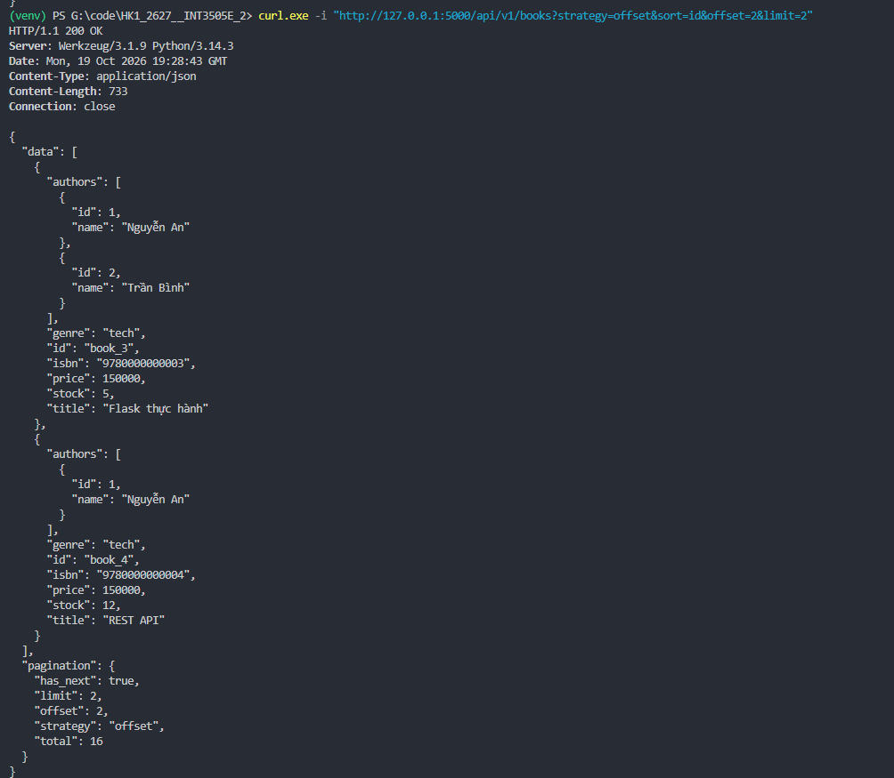
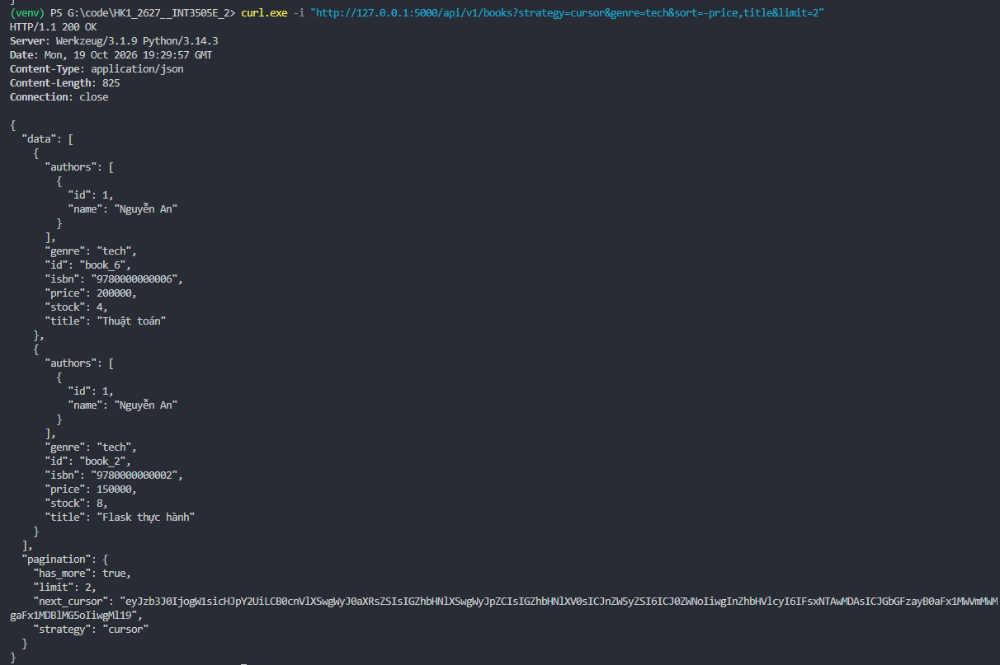
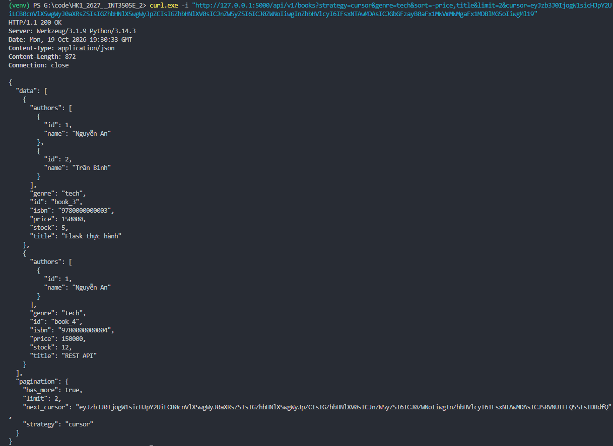
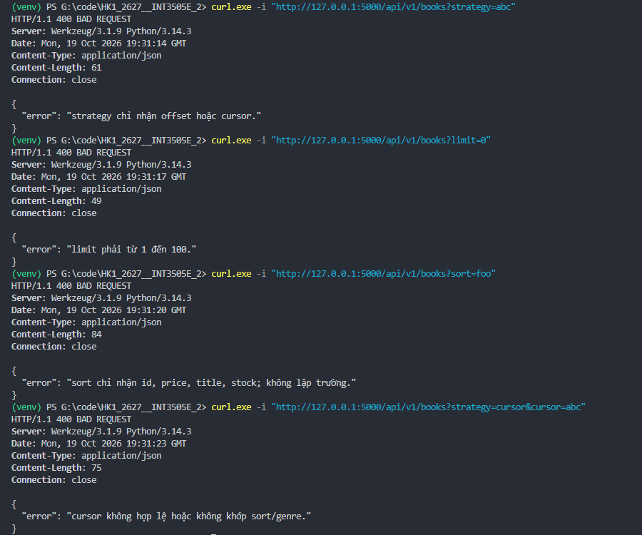
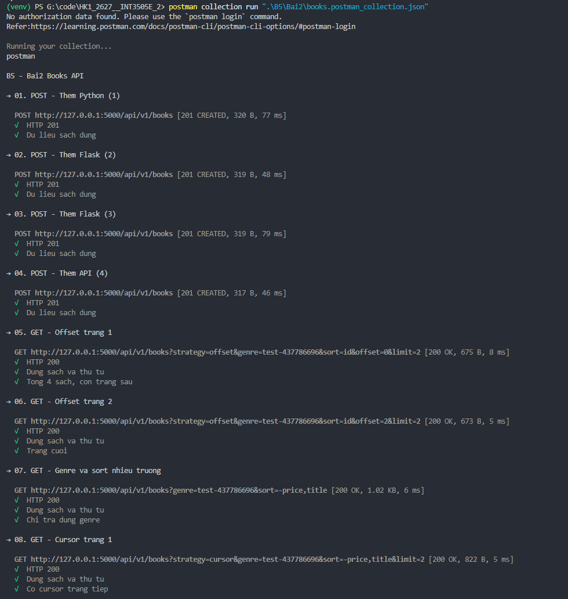
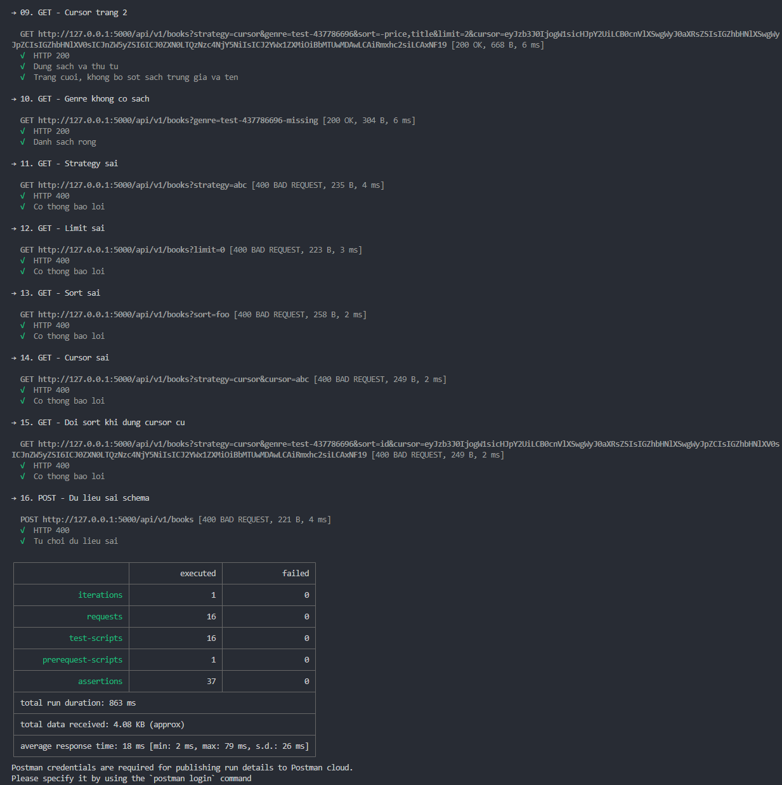

# BT Buổi 5

## Bài 2: Flask pagination

Hoàn thiện `list_books` với phân trang offset và cursor, lọc theo `genre` và sort nhiều trường trên endpoint `/api/v1/books`.

### Kết quả test bằng curl

**1. Lấy danh sách sách — GET /api/v1/books:**

- Trả về `200 OK`, body chứa danh sách sách trong `data`.
- Mặc định sort theo `-id`, sách có ID lớn nhất xuất hiện trước.

**2. Kiểm tra thông tin phân trang mặc định:**

- Response có `strategy: "offset"`, `offset: 0` và `limit: 20`.
- Tại thời điểm chụp ảnh, database có `total: 16`; `has_next: false` vì không còn trang tiếp theo.

**3. Kiểm tra phân trang bằng offset:**

- Gọi `GET /api/v1/books?strategy=offset&sort=id&offset=2&limit=2`, trả về `200 OK`.
- Bỏ qua 2 sách đầu, trả về `book_3` và `book_4` theo ID tăng dần.
- `has_next: true` vì vẫn còn dữ liệu ở trang tiếp theo.

**4. Kiểm tra cursor kết hợp lọc genre và sort nhiều trường:**

- Gọi `GET /api/v1/books?strategy=cursor&genre=tech&sort=-price,title&limit=2`, trả về `200 OK`.
- Chỉ lấy sách thuộc thể loại `tech`, sort theo giá giảm dần rồi tên tăng dần.
- Trang đầu trả về `book_6` giá 200000 và `book_2` giá 150000.
- Response có `has_more: true` và `next_cursor` để lấy trang tiếp theo.

**5. Kiểm tra lấy trang tiếp theo bằng cursor:**

- Gửi lại `next_cursor` của trang trước qua tham số `cursor`, giữ nguyên `genre` và `sort`.
- Trả về `200 OK` với `book_3` và `book_4`, không lặp sách ở trang trước.
- `book_2` và `book_3` trùng cả giá lẫn tên nhưng vẫn được lấy đủ nhờ khóa phụ `id`.
- `has_more: true` cho biết vẫn còn trang tiếp theo.

**6. Kiểm tra tham số không hợp lệ:**

- `strategy=abc`: trả về `400 BAD REQUEST` vì chỉ hỗ trợ `offset` hoặc `cursor`.
- `limit=0`: trả về `400 BAD REQUEST` vì limit phải từ 1 đến 100.
- `sort=foo`: trả về `400 BAD REQUEST` vì trường sort không được hỗ trợ.
- `strategy=cursor&cursor=abc`: trả về `400 BAD REQUEST` vì cursor không hợp lệ.
- Mỗi response có trường `error` giải thích nguyên nhân.

### Kết quả test bằng Postman CLI

Collection: [books.postman_collection.json](Bai2/books.postman_collection.json).

**1. Thêm dữ liệu và kiểm tra các chức năng chính:**

- 4 request `POST /api/v1/books` thêm sách thành công, trả về `201 CREATED`.
- Các request GET kiểm tra offset trang 1, trang 2, lọc genre, sort nhiều trường và cursor trang đầu đều trả về `200 OK`.
- Các kiểm tra dữ liệu và thứ tự sách đều đạt.
- Mỗi lần chạy collection dùng ISBN và genre mới để không trùng dữ liệu test của lần chạy trước.

**2. Kiểm tra cursor, dữ liệu rỗng, lỗi đầu vào và tổng kết:**

- Cursor trang 2 trả đúng dữ liệu, không bỏ sót sách trùng giá và tên.
- Genre không có sách trả về `200 OK` với danh sách rỗng.
- Strategy, limit, sort, cursor sai hoặc đổi sort khi dùng cursor cũ đều trả về `400 BAD REQUEST`.
- POST dữ liệu sai JSON Schema cũng trả về `400 BAD REQUEST`.
- Tổng cộng **16 request, 37 assertions, 0 lỗi**. Các request cố tình gửi sai vẫn đạt test vì trả đúng mã lỗi mong đợi.
- Thông báo đăng nhập chỉ liên quan đến gửi kết quả lên Postman Cloud; collection cục bộ vẫn chạy thành công.
