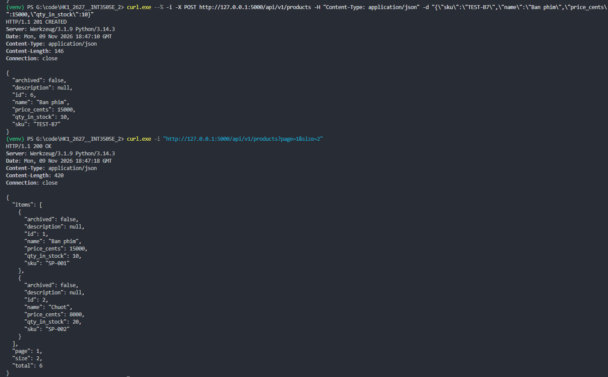
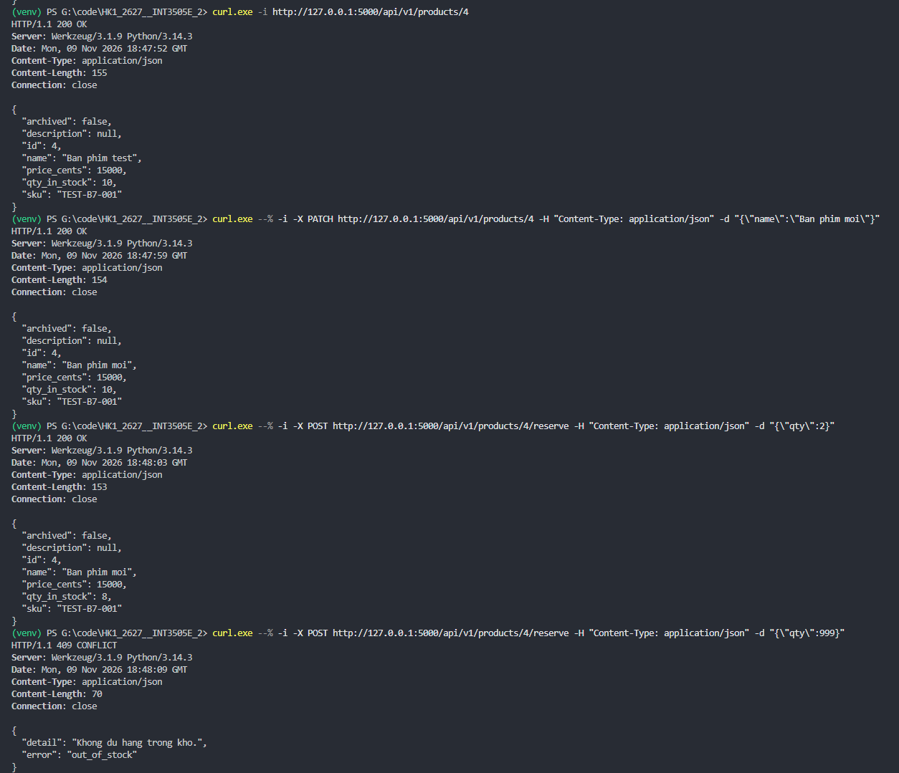
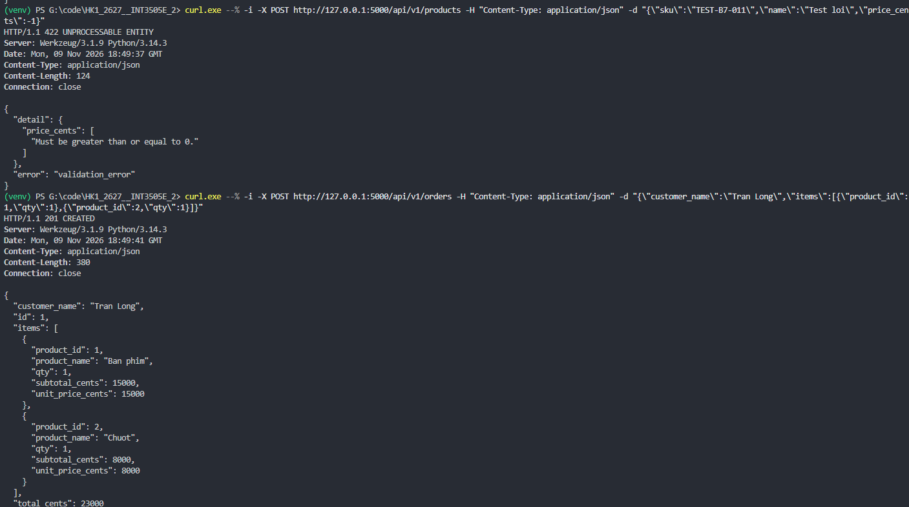
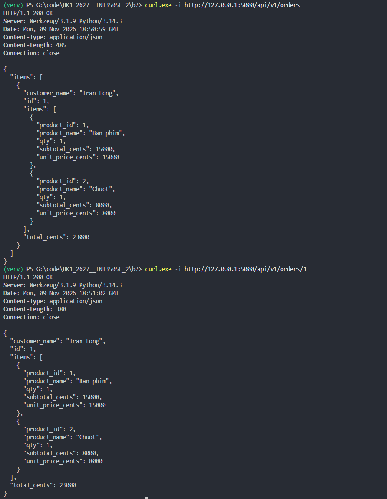
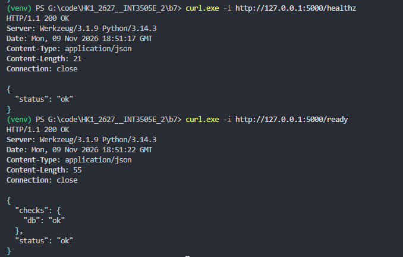
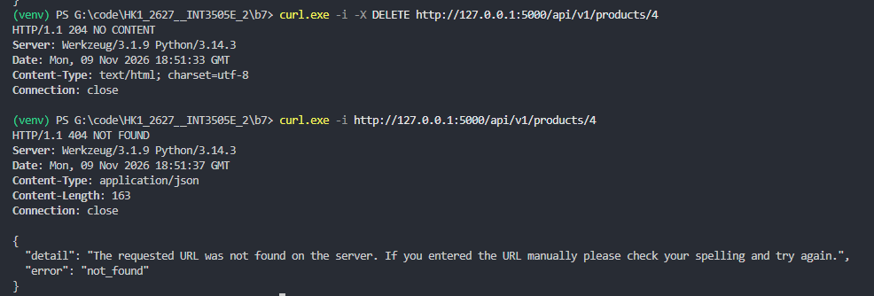
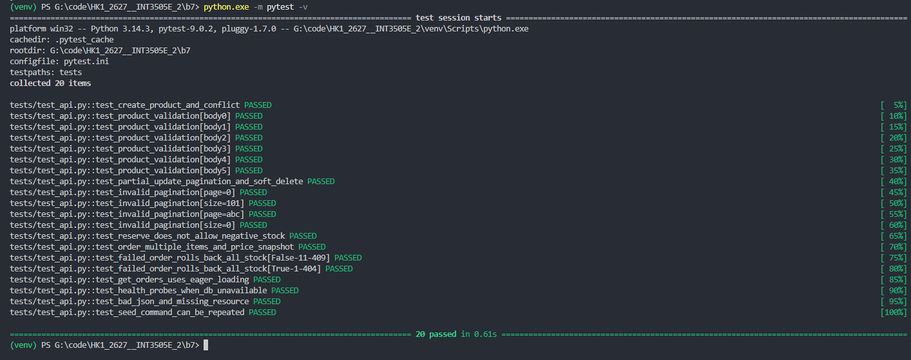
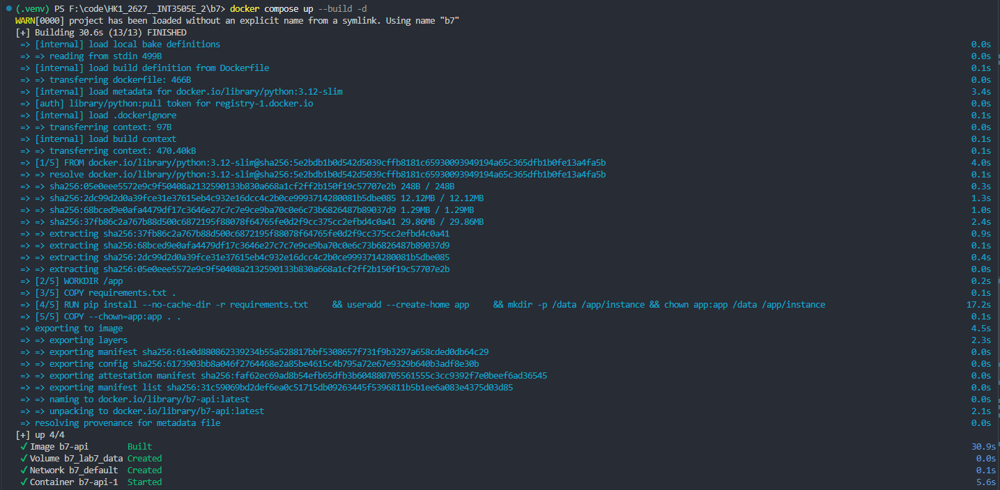
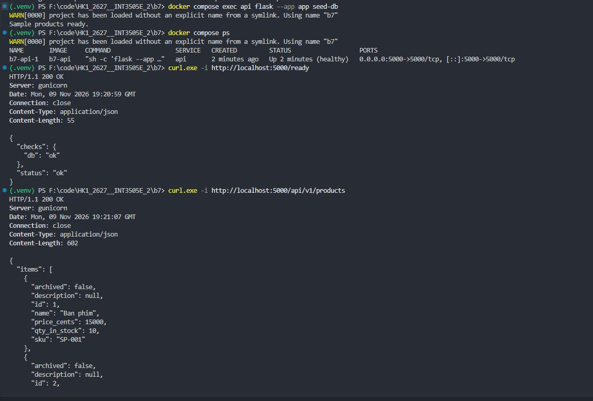
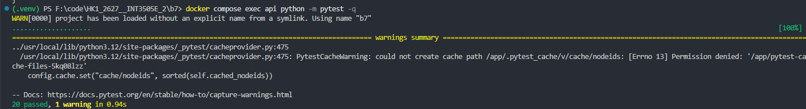

# BT Buổi 7

## Kết quả test bằng curl



**1. Tạo sản phẩm và lấy danh sách:**

- `POST /api/v1/products` trả về `201 CREATED`, tạo sản phẩm `TEST-B7` có id `6`, giá `15000` và tồn kho `10`.
- `GET /api/v1/products?page=1&size=2` trả về `200 OK`, lấy 2 sản phẩm của trang đầu.
- Response có `items`, `page: 1`, `size: 2` và `total: 6` tại thời điểm test.



**2. Lấy chi tiết, cập nhật và đặt trước sản phẩm:**

- `GET /api/v1/products/4` trả về `200 OK`, hiển thị thông tin sản phẩm id `4`.
- `PATCH /api/v1/products/4` đổi tên thành `Ban phim moi`; giá và tồn kho giữ nguyên.
- `POST /api/v1/products/4/reserve` với `qty: 2` trả về `200 OK`, tồn kho giảm từ `10` xuống `8`.
- Reserve với `qty: 999` trả về `409 CONFLICT`, lỗi `out_of_stock` do không đủ hàng.



**3. Validate dữ liệu và tạo đơn hàng:**

- Tạo sản phẩm với `price_cents: -1` trả về `422 UNPROCESSABLE ENTITY`, lỗi `validation_error` chỉ rõ giá phải lớn hơn hoặc bằng 0.
- `POST /api/v1/orders` trả về `201 CREATED`, tạo đơn id `1` cho khách hàng `Tran Long`.
- Đơn có 2 dòng sản phẩm: `Ban phim` giá `15000` và `Chuot` giá `8000`, mỗi loại 1 sản phẩm; tổng tiền `23000`.



**4. Lấy danh sách và chi tiết đơn hàng:**

- `GET /api/v1/orders` và `GET /api/v1/orders/1` đều trả về `200 OK`.
- Kết quả có thông tin khách hàng, các dòng sản phẩm, số lượng, đơn giá và tổng tiền `23000`.
- Một Order liên kết nhiều Product thông qua OrderItem.



**5. Kiểm tra trạng thái service:**

- `GET /healthz` trả về `200 OK` với `status: "ok"`, xác nhận ứng dụng đang chạy.
- `GET /ready` trả về `200 OK` với `checks.db: "ok"`, xác nhận database sẵn sàng.
- Hai chức năng sử dụng hai endpoint riêng biệt.



**6. Xóa mềm sản phẩm:**

- `DELETE /api/v1/products/4` trả về `204 NO CONTENT`, không có response body.
- `GET /api/v1/products/4` sau khi xóa trả về `404 NOT FOUND`.
- Sản phẩm được đánh dấu `archived=true` và không còn được trả về qua API sản phẩm.

## Kết quả test bằng pytest



**7. Kiểm thử tự động:**

- Chạy `python.exe -m pytest -v`, kết quả **20 passed**, không có test thất bại.
- Kiểm tra tạo sản phẩm, trùng SKU, validation, phân trang, cập nhật, xóa mềm và reserve không âm tồn kho.
- Kiểm tra đơn nhiều sản phẩm, lưu giá tại thời điểm đặt hàng và rollback khi tạo đơn thất bại.
- Test GET orders có eager loading đạt: tạo 5 đơn, mỗi đơn 3 sản phẩm và kiểm tra chỉ có 2 truy vấn SELECT để tránh N+1.
- Các test health check, JSON sai cú pháp và lệnh tạo dữ liệu mẫu cũng đạt.

## Đóng gói và kiểm thử bằng Docker

Service được đóng gói bằng [Dockerfile](Dockerfile) và [docker-compose.yml](docker-compose.yml). Dockerfile cài các thư viện từ `requirements.txt`, chạy ứng dụng bằng Gunicorn với user `app`. Compose cấu hình cổng `5000:5000`, biến môi trường `DB_URL=sqlite:////data/lab7.db`, volume `lab7_data` lưu database và healthcheck qua `/ready`.



**8. Build và khởi động container:**

```powershell
docker compose up --build -d
```

- Build thành công image `b7-api` từ Dockerfile.
- Docker Compose tạo volume `b7_lab7_data`, network `b7_default` và khởi động container `b7-api-1`.



**9. Kiểm tra service và database trong Docker:**

```powershell
docker compose exec api flask --app app seed-db
docker compose ps
curl.exe -i http://localhost:5000/ready
curl.exe -i http://localhost:5000/api/v1/products
```

- Lệnh tạo dữ liệu mẫu trả về `Sample products ready.`.
- Container `b7-api-1` có trạng thái `healthy`, công khai cổng `5000`.
- `GET /ready` trả về `200 OK`, có `status: "ok"` và `checks.db: "ok"`.
- `GET /api/v1/products` trả về `200 OK` cùng dữ liệu sản phẩm mẫu; response có header `Server: gunicorn`.



**10. Kiểm thử tự động trong container:**

```powershell
docker compose exec api python -m pytest -q
```

- Kết quả **20 passed, 1 warning in 0.94s**, không có test thất bại.
- Cảnh báo `PytestCacheWarning` do pytest không có quyền ghi cache tại `/app/.pytest_cache`; không ảnh hưởng kết quả kiểm thử. Có thể chạy `docker compose exec api python -m pytest -v -p no:cacheprovider` để tắt cache và hiển thị tên từng test.


