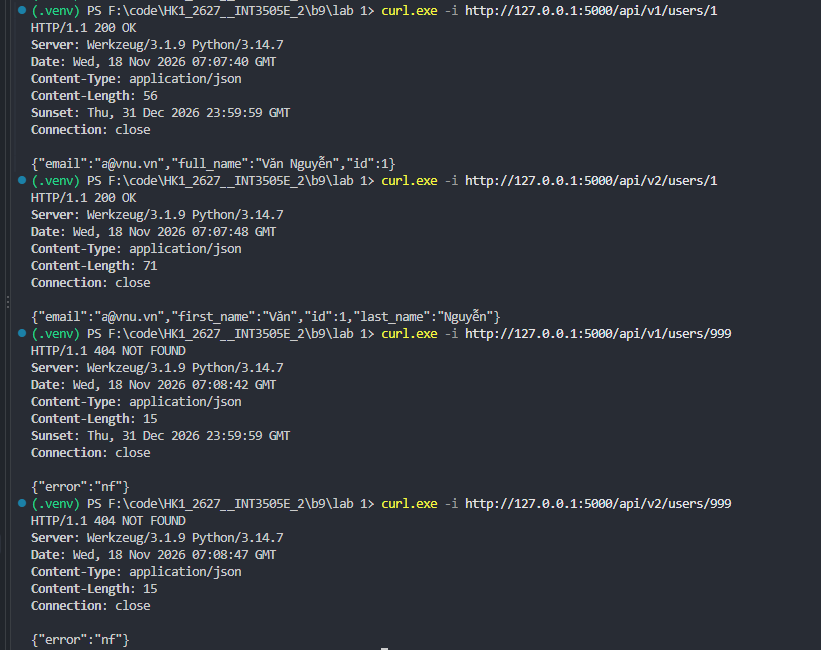
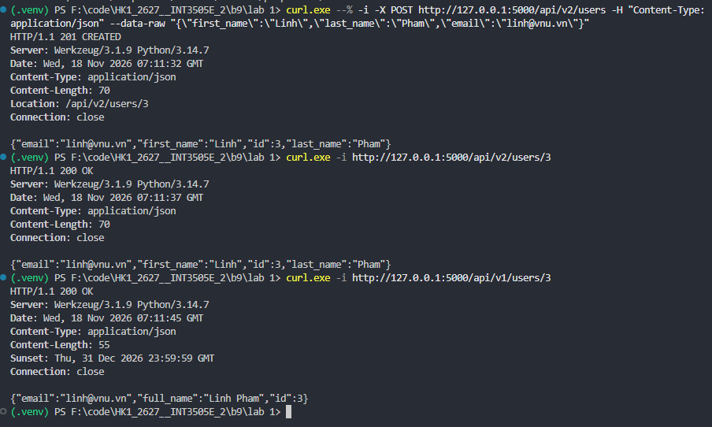

# Practice 1 - API Versioning với Flask Blueprint

Xây dựng User API với hai phiên bản chạy đồng thời: v1 trả `full_name`, v2 trả
`first_name` và `last_name`. Hai phiên bản dùng chung dữ liệu.

## Kết quả test bằng curl



**1. Kiểm tra GET v1, v2 và header Sunset:**

- `GET /api/v1/users/1`: trả `200 OK`, tên đầy đủ trong `full_name`.
- `GET /api/v2/users/1`: trả `200 OK`, tên tách thành `first_name` và `last_name`.
- User không tồn tại (`id = 999`): cả hai phiên bản trả `404` với `{"error":"nf"}`.
- Response v1 có header `Sunset: Thu, 31 Dec 2026 23:59:59 GMT`; v2 không có.
  Đây là ngày minh họa thông báo ngừng hỗ trợ, không tự tắt API.



**2. Tạo user qua v2 và đọc lại qua hai phiên bản:**

- `POST /api/v2/users`: tạo user `Linh Pham`, trả `201 Created` và header
  `Location: /api/v2/users/3`.
- Đọc user mới qua v2: trả `first_name: "Linh"`, `last_name: "Pham"`.
- Đọc cùng user qua v1: trả `full_name: "Linh Pham"`, cho thấy hai phiên bản
  dùng chung dữ liệu nhưng có cấu trúc response khác nhau.

## OpenAPI

Đặc tả API nằm trong [openapi.yaml](openapi.yaml), mô tả GET v1/v2,
POST v2, dữ liệu request/response và header Sunset.
Có thể xem tại `http://127.0.0.1:5000/openapi.yaml` khi server đang chạy.

Sau khi chạy ứng dụng, mở PowerShell khác và gọi:

```powershell
curl.exe -i http://127.0.0.1:5000/openapi.yaml
```

Kết quả trả về `200 OK` cùng nội dung đặc tả OpenAPI ở định dạng YAML.

## Chạy ứng dụng

Từ thư mục `B9/Lab 1`:

```powershell
python -m venv .venv
.\.venv\Scripts\python.exe -m pip install -r requirements.txt
.\.venv\Scripts\python.exe app.py
```

Server chạy tại `http://127.0.0.1:5000`. Dữ liệu lưu trong bộ nhớ và được
khởi tạo lại khi khởi động lại ứng dụng.
