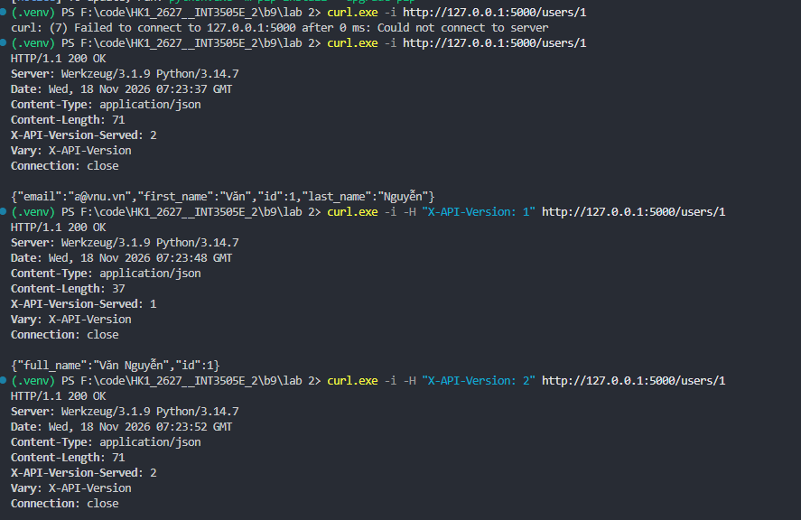
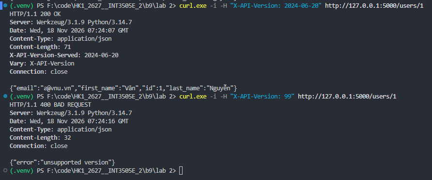

# Practice 2 - Header Versioning với decorator

Cùng endpoint `GET /users/{id}`, client chọn phiên bản qua header
`X-API-Version`. Decorator `@api_version()` kiểm tra version và thêm header
`X-API-Version-Served` vào response cho biết phiên bản đã phục vụ.




**1. Kiểm tra version mặc định, v1 và v2:**

- Không gửi `X-API-Version`: trả `200 OK`, mặc định dùng v2 với các trường
  `id`, `first_name`, `last_name`, `email` và header `X-API-Version-Served: 2`.
- Gửi `X-API-Version: 1`: trả `200 OK`, dữ liệu có `id` và
  `full_name: "Văn Nguyễn"`, header `X-API-Version-Served: 1`.
- Gửi `X-API-Version: 2`: trả `200 OK`, header `X-API-Version-Served: 2`.
- Header `Vary: X-API-Version` cho biết response thay đổi theo version được chọn.
- Lần gọi đầu trong ảnh chưa kết nối được server; gọi lại sau đó đã thành công.



**2. Kiểm tra phiên bản theo ngày và version không hỗ trợ:**

- Gửi `X-API-Version: 2024-06-20`: trả `200 OK`, có các trường
  `id`, `first_name`, `last_name`, `email`, giống cấu trúc v2.
- Response có header `X-API-Version-Served: 2024-06-20`.
- Gửi `X-API-Version: 99`: trả `400 BAD REQUEST` với
  `{"error":"unsupported version"}`, không tự chuyển về version mặc định.

## Chạy ứng dụng

Từ thư mục `B9/Lab 2`:

```powershell
python -m venv .venv
.\.venv\Scripts\python.exe -m pip install -r requirements.txt
.\.venv\Scripts\python.exe app.py
```
