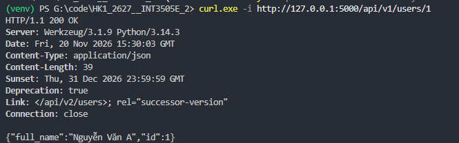
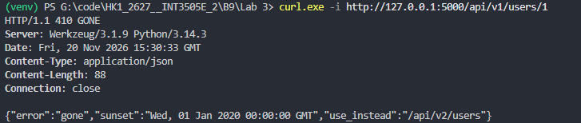

# Practice 3 - Sunset middleware: decorator `@deprecate_at`

Sử dụng decorator `@deprecate_at()` trong `sunset.py` để thông báo thời hạn
ngừng hỗ trợ API v1. Trước sunset, API vẫn hoạt động và trả các header cảnh báo;
từ thời điểm sunset, API trả `410 Gone`. Mỗi lần gọi đều ghi warning log.



**1. Kiểm tra API trước sunset:**

- `GET /api/v1/users/1`: trả `200 OK`, dữ liệu có `id: 1` và
  `full_name: "Nguyễn Văn A"`.
- Header `Sunset: Thu, 31 Dec 2026 23:59:59 GMT` thông báo thời hạn
  ngừng hỗ trợ API v1.
- Header `Deprecation: true` cho biết API đã được đánh dấu ngừng khuyến nghị sử dụng.
- Header `Link: </api/v2/users>; rel="successor-version"` chỉ đến API thay thế.



**2. Kiểm tra API sau sunset:**

- Tạm đặt `V1_SUNSET = datetime(2020, 1, 1, tzinfo=timezone.utc)` trong
  `app.py`, khởi động lại server và gọi cùng endpoint.
- `GET /api/v1/users/1`: trả `410 Gone`, không còn trả dữ liệu user.
- Response có `error: "gone"`, thời hạn
  `sunset: "Wed, 01 Jan 2020 00:00:00 GMT"` và
  `use_instead: "/api/v2/users"`.
- Sau khi thử, khôi phục thời hạn mặc định về `31/12/2026 23:59:59 UTC`.

Hai ảnh trên sử dụng cùng lệnh:

```powershell
curl.exe -i http://127.0.0.1:5000/api/v1/users/1
```

Để kiểm tra warning log, quan sát terminal chạy Flask khi gọi API trước
và sau sunset. Mỗi lần gọi có log dạng:

```text
deprecated_call /api/v1/users/1 127.0.0.1
```
