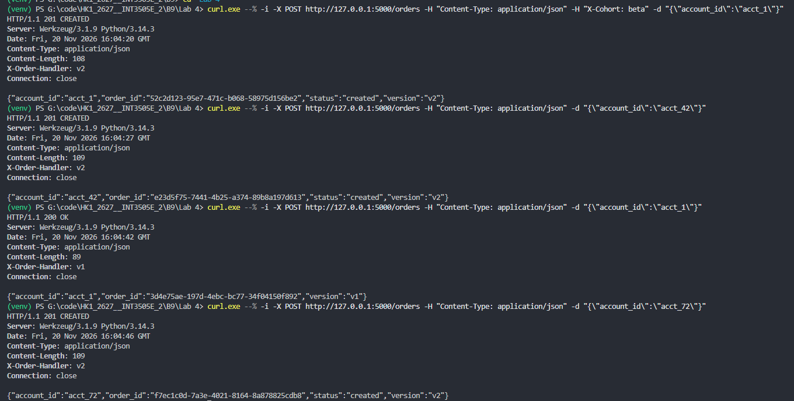
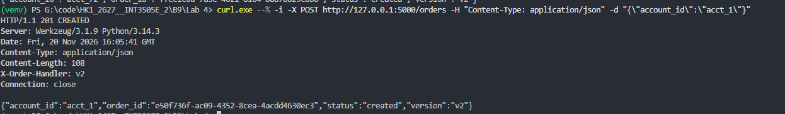

# Practice 4 - Blue-Green routing theo cohort

Cùng endpoint `POST /orders`, gateway chọn handler v1 hoặc v2 theo thứ tự:
header `X-Cohort`, danh sách tài khoản ưu tiên, rồi hash bucket theo phần trăm.
Response có header `X-Order-Handler` cho biết phiên bản đã xử lý.



**1. Kiểm tra cohort, allow-list và rollout 5%:**

- Gửi `X-Cohort: beta` với `account_id: "acct_1"`: trả `201 Created`,
  header `X-Order-Handler: v2` và `version: "v2"`.
- Gửi `account_id: "acct_42"` không kèm cohort: vẫn dùng v2 vì tài khoản
  nằm trong allow-list, trả `201 Created`.
- Với `V2_PERCENT = 5`, tài khoản thường `acct_1` thuộc bucket 53 nên dùng v1,
  trả `200 OK` và header `X-Order-Handler: v1`.
- Tài khoản thường `acct_72` thuộc bucket 3 nên dùng v2, trả `201 Created`
  và header `X-Order-Handler: v2`.
- Response v1 có `account_id`, `order_id`, `version`; response v2 có thêm
  `status: "created"`.



**2. Kiểm tra rollout 100%:**

- Đổi `V2_PERCENT = 100` trong `gateway.py`, khởi động lại server và gọi lại
  `POST /orders` với `account_id: "acct_1"`.
- Tài khoản trước đó dùng v1 nay trả `201 Created`, header
  `X-Order-Handler: v2`, `version: "v2"` và `status: "created"`.
- Khi rollout đạt 100%, mọi tài khoản đều được xử lý bởi v2.
- Sau khi thử, khôi phục `V2_PERCENT = 5`.

Các lệnh trong ảnh chạy trên PowerShell; `--%` giữ nguyên dấu ngoặc kép
trong JSON, toàn bộ thông tin request đặt sau `curl.exe`:

```powershell
curl.exe --% -i -X POST http://127.0.0.1:5000/orders -H "Content-Type: application/json" -H "X-Cohort: beta" -d "{\"account_id\":\"acct_1\"}"

curl.exe --% -i -X POST http://127.0.0.1:5000/orders -H "Content-Type: application/json" -d "{\"account_id\":\"acct_42\"}"

curl.exe --% -i -X POST http://127.0.0.1:5000/orders -H "Content-Type: application/json" -d "{\"account_id\":\"acct_1\"}"

curl.exe --% -i -X POST http://127.0.0.1:5000/orders -H "Content-Type: application/json" -d "{\"account_id\":\"acct_72\"}"
```

Ảnh thứ hai sử dụng lại lệnh của `acct_1` không kèm cohort sau khi đổi tỷ lệ
rollout lên 100%. Cùng tài khoản và cấu hình luôn chọn cùng phiên bản;
mỗi request tạo một `order_id` mới. Các handler chỉ mô phỏng tạo đơn,
không lưu dữ liệu.

Theo lộ trình trên slide, khi v2 ổn định ở 100%, có thể thông báo sunset
và lưu trữ v1 sau 30 ngày. Đây là bước vận hành, code lab không tự đếm ngày
hay tự xóa handler v1.
